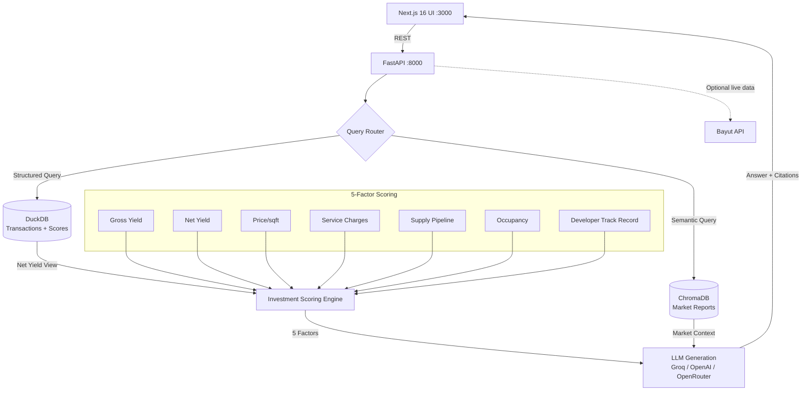

# Dubai Property Investment Assistant

AI-powered investment scoring and Q&A for Dubai real estate. Calculates net yield, flags supply risk, and scores communities on 5 weighted factors (see Known limitations before quoting a number).

**Stack:** Next.js 16 + FastAPI + DuckDB + ChromaDB + Groq (LLM) + Bayut API (live listings)

## Architecture



## Quick Start

```bash
# Clone
git clone https://github.com/ahmedbasolan/dubai-property-bot.git
cd dubai-property-bot

# Setup (generate data + load DuckDB + ingest ChromaDB)
make setup

# Configure keys
cp .env.example .env
# Edit .env — add at least one of:
#   GROQ_API_KEY (free: console.groq.com/keys) — recommended
#   OPENAI_API_KEY / OPENROUTER_API_KEY
# Optional: BAYUT_API_KEY for live listings (RapidAPI)

# Terminal 1 — backend (FastAPI)
make run-api        # http://localhost:8000  (docs at /docs)

# Terminal 2 — frontend (Next.js)
make run-ui         # http://localhost:3000
```

Docker (optional):

```bash
docker compose up --build
```

The API image builds `data/dubai_properties.duckdb` and the ChromaDB store on
first start (`docker-entrypoint.sh`), because both are gitignored build
artefacts. The web service runs `npm run build` before `next start`.

## Pages

| Route | Purpose |
|-------|---------|
| `/` | Dashboard: KPIs, community scores, yield distribution |
| `/communities` | 5-factor scores with INVEST / HOLD / AVOID signals |
| `/properties` | Filterable property list (live Bayut data when configured) |
| `/compare` | Side-by-side community comparison |
| `/map` | Leaflet map of communities (dark theme) |
| `/trends` | Price/sqft trends, top gainers, volume |
| `/calculator` | Mortgage + STR yield calculators |
| `/chat` | RAG chat advisor (markdown answers with tables) |

Brand assets: `/brand/brand-book.html`, `/brand/luxury-gold.html`, `/brand/showcase.html`

## What It Does

**Investment Scoring** — Every community gets a composite score (20-100) from five weighted factors:

| Metric | Weight | What It Measures |
|--------|--------|------------------|
| Gross Yield | 25% | Rental income relative to price |
| Net Yield | 25% | After service charges, management, vacancy |
| Supply Pipeline | 20% | New units incoming = risk |
| Occupancy | 15% | Current take-up |
| Service Charges | 15% | Lower = better net returns |

Each factor is graded A–F against fixed thresholds (`src/db_setup.py`), mapped to 1–5
points and weighted. **Recommendations are bands on that same score**: INVEST ≥ 70,
HOLD ≥ 50, AVOID < 50 — the number and the signal come from one rule set, so they cannot
disagree. Price/sqft is displayed as a grade but not weighted: it is a relative-value
signal, while the score models return and risk. Size is derived from price through each
community's price density, so AED/sqft stays within a plausible band.

**Net Yield Calculation:**
```
Net Yield = (Annual Rent - Service Charges - Management Fees - Vacancy Loss) / Price × 100
```
- Service Charges = size × service_charge_per_sqft
- Management Fees = 8% of annual rent
- Vacancy Loss = 5% of annual rent (~2-3 weeks/year)

## Data

- **74 synthetic transactions** across 24 Dubai communities (DuckDB). They are
  generated by `src/generate_data.py` (seeded, reproducible) from per-community
  profiles — modelled on Dubai, **not** DLD records. Size is derived from price
  through each community's AED/sqft density. `BAYUT_API_KEY` adds live listings
  alongside them.
- **288 quarterly price points** in `price_history`: 12 quarters per community,
  latest quarter anchored to the transaction sample (see Known limitations)
- **28 market report chunks** in ChromaDB (semantic retrieval)
- **Views:** `v_net_yield` (deterministic yield), `v_investment_scores` (5 weighted factors → INVEST/HOLD/AVOID)
- **Bayut API** optional: live listings, sale prices, community objects
- **7 extra fields:** floor level, view type, service charges, parking, completion year, furnishing, amenities

## Example Questions

- "Which community has the best ROI for 1BR under 1.5M?"
- "Compare net yield between Dubai Marina and JVC"
- "What's the supply risk in DAMAC Hills 2?"
- "Is Downtown Dubai a good investment right now?"
- "Recommend top 3 communities for a first-time investor with AED 1M budget"

## Tech Stack

| Component | Technology | Purpose |
|-----------|-----------|---------|
| Frontend | Next.js 16, React 19, Tailwind 4, shadcn/ui | Dashboard, chat, charts, map |
| Charts / Map | Recharts, Leaflet (react-leaflet) | Trends, scores, community map |
| Backend | FastAPI (Python) | REST API + RAG orchestration |
| Structured Analytics | DuckDB | Transaction queries, net yield, scoring |
| Semantic Search | ChromaDB | Market report retrieval |
| Embeddings | all-MiniLM-L6-v2 | Report chunk embedding |
| LLM | Groq `gpt-oss-120b` (default), OpenAI, OpenRouter | Answer generation |
| Live Data | Bayut API (RapidAPI) | Listings, sale prices |
| Design | Custom Luxury Gold design system | Brand book, logos, banners |
| Container | Docker (optional) | Deployment |

## API

Interactive docs: `http://localhost:8000/docs`

| Endpoint | Method | Purpose |
|----------|--------|---------|
| `/api/health` | GET | Service + data source status |
| `/api/chat` | POST | RAG answer (markdown). Body: `{q, provider?, api_key?, model?}` |
| `/api/chat?q=...` | GET | Deprecated; server key only, never accepts `api_key` |
| `/api/communities` | GET | Scores + recommendations |
| `/api/transactions` | GET | Paginated listing (`limit`, `offset`, `use_live=true` for Bayut) |
| `/api/scores` | GET | Investment scores |
| `/api/trends` | GET | Price/sqft time series |
| `/api/trends/top-gainers` | GET | Top gaining communities |
| `/api/trends/top-volume` | GET | Highest volume communities |
| `/api/mortgage?property_price=...` | GET | Mortgage + acquisition cost |
| `/api/developers` | GET | Developer scorecards |
| `/api/map` | GET | GeoJSON for Leaflet |

## Running Evaluations

```bash
make eval
```

**30-question suite** with automated checks:
- Keyword matching (answer relevance)
- Percentage claims validated against the dataset's own range — a *range* check,
  not an accuracy measure: a fabricated 7.0% passes as long as the real column
  spans it (see `REVIEW.md`)
- Community attribution (entity names must exist in DB, alias-normalized)

Latest complete run (Groq `openai/gpt-oss-120b`): 29 of 30. The failure was an HTTP
413, but not because the context was 10k tokens: the context is ~5.2k, and Groq
counts the prompt **and** `max_tokens` against its 8,000 TPM cap, so the old 4k
ceiling made the request ~10k. `LLM_MAX_TOKENS` is now 1,500 with a request-budget
guard. A fresh run cleared its first 20 questions before the daily quota ran out;
its Q20 response also exposed a top-8 truncation for comparisons (fixed and
unit-tested), and Q20 was re-checked on `openai/gpt-oss-20b`, where it correctly
compares both scores (70 vs 63). A full 120b re-run is pending quota.

| Metric | Result |
|--------|--------|
| Successful | 29 / 30 |
| Avg keyword score | 56% |
| Percentage claims outside dataset range | 0 (reported as "100% number accuracy" in earlier revisions) |
| Community attribution | **100%** |

Harness tests: `pytest eval/test_run_eval.py` — 14 tests covering the checks themselves.

### Retrieval sampling

Transaction context is sampled across the dataset, not taken as a global top-N by
yield. A plain `ORDER BY net_yield_pct DESC LIMIT 15` exposed only 5 of 24
communities and **zero** villas, so the model correctly reported that no villa
data existed while the database held 9. The current query ranks
`community + property_type` groups by how scarce they are, so a lone penthouse
is never truncated, and derives the per-group cap from the group count so a
narrow filter still returns its whole set. Cap: 40 rows.

Every response also carries an exact **coverage manifest** (counts by property
type, developer, handover status and bedrooms) plus an explicit instruction not
to total the sample rows. Without it the model cannot tell "no such property"
from "not in the rows I was shown", and it answers the second one.

The LLM request budget counts **prompt + `max_tokens`** because Groq's free tier
counts both against its 8,000 TPM limit. `LLM_MAX_TOKENS` is 1,500, and
`generate_answer()` lowers it further when the prompt grows, so a larger context
cannot turn into a deterministic 413. Single-community queries also get one
compact `price_history` line, so trend answers cite the same DuckDB series as
`/api/trends`.

### Deterministic filter extraction

`filters` used to be a parameter no caller ever populated, so every query ran
unfiltered. `src/filters.py` now derives them from the query text without an
LLM call — the same reason financial figures come from SQL views and not
generation. It extracts community (with aliases: `JVC`, `downtown`, `DSO`,
`marina` → the exact column values), property type, bedrooms and price bounds.

Two rules keep a wrong filter from becoming a false "no data" answer:

1. **Never narrow on a guess.** Bare numbers ("top 3 communities"), percentages and
   undirected prices are left unfiltered, and every omission is recorded in
   `skipped_filters` and shown to the model. A comparison ("compare Marina and
   JVC") is scoped to the communities it names — leaving it unfiltered returned all
   24 scores and then showed the top 8, so both compared communities could be
   missing from the prompt.
2. **Never narrow to nothing.** If a filter matches zero rows the query is
   retried unfiltered and the relaxation is reported in the context.

`community` and `property_type` are matched with `ILIKE`, not `=`: the columns
hold `'Business Bay'` and `'Villa'`, so a case-mismatched filter would match
nothing. Community and property-type filters also scope the investment-score and
supply tables, and the semantic branch is scoped to the community's own market
report where one exists — unscoped, a DAMAC Hills 2 question was answered from
the *Dubai Hills* report. Only 4 of 24 communities have a report; for the rest
the gap is stated rather than papered over.

Tests: `pytest tests/ eval/test_run_eval.py` - 81 covering extraction, the
relaxation safety net, semantic scoping, the eval harness itself, the REST
contract (list endpoint returning every row, 404s, score/signal agreement), and
data quality (price/size correlation, AED/sqft band, trend/scores anchor).

The runner loads `.env` automatically and **resumes**: re-run `make eval` to fill in
questions that failed without redoing successes. TPM 429s retry with exponential
backoff; the request budget keeps prompt + `max_tokens` under the tier's 8k TPM, and
TPD exhaustion fails with a clear message that can be resumed after the reset.

## Project Structure

```
dubai-property-bot/
├── api/
│   └── main.py            # FastAPI app (REST + RAG endpoints)
├── src/
│   ├── rag.py             # RAG pipeline (DuckDB + ChromaDB + LLM)
│   ├── bayut_provider.py  # Bayut API client (live data)
│   ├── data_provider.py   # Data provider abstraction
│   ├── db_setup.py        # DuckDB schema + views + scoring
│   ├── ingest.py          # ChromaDB ingestion
│   ├── calculators.py     # Mortgage, STR yield
│   ├── price_trends.py    # Quarterly series from price_history (DuckDB)
│   ├── developer_scorecard.py  # Developer aggregation of community scores
│   └── generate_data.py   # Mock data generator
├── frontend/              # Next.js 16 app
│   └── src/app/           # dashboard, chat, communities, map, ...
│   └── public/brand/      # brand book, logos, banners
├── eval/
│   ├── eval_set.json      # 30 evaluation questions
│   ├── run_eval.py        # Evaluation runner (loads .env)
│   └── eval_results.json  # Latest results
├── tests/
│   ├── test_filters.py    # deterministic extraction + relaxation
│   └── test_api.py        # REST contract (pagination, 404s, score/signal)
├── data/                  # DuckDB + raw/processed data
├── chroma_db/             # Vector store
├── .env.example           # Keys template
├── docker-entrypoint.sh   # Builds DuckDB + ChromaDB on first container start
├── Dockerfile
├── docker-compose.yml
├── Makefile
├── REVIEW.md              # Code review: verified defects and open limitations
└── CASE_STUDY.md
```

## Design

The UI uses a custom **Luxury Gold** design system (`#D4AF37` primary, Cinzel + Josefin Sans typography). See:

- `frontend/public/brand/BRAND-IDENTITY.md` — tokens and voice
- `frontend/public/brand/brand-book.html` — full guidelines
- `frontend/public/brand/luxury-gold.html` — palette exploration

## Known limitations

`REVIEW.md` has the full list. The ones that change how results should be read:

- **Synthetic data.** 74 generated transactions, 2-5 per community, so every
  community average is an average of very few points.
- **Trends are partly modelled.** `/trends` reads `price_history` from DuckDB and its
  latest quarter is anchored to the same AED/sqft the scores use. Earlier quarters are
  walked backwards with a 2022-2024 growth curve, and volume is modelled from stock
  turnover - the API and the page both say so. Developer scorecards are a
  transaction-weighted aggregation of the community scores; delivery timeliness,
  appreciation and RERA standing are not in the dataset and are not reported.
- **Chat trends are scoped.** A single-community question gets one compact
  `price_history` line (the same series as `/api/trends`); comparisons and broad
  questions do not, to keep the prompt inside the free tier's TPM budget.
- **Two developer fields, reconciled.** `transactions.developer` is the builder
  recorded on the transaction; `communities.master_developer` is the community's
  master developer. Builders for `"Various"` communities are sampled from a pool
  that excludes every master developer with a scorecard, so a scorecard's
  `transaction_count` equals the raw count by `developer`.
- **The eval's number check is a range check**, not per-question accuracy.
- **No authentication.** Chat is rate limited per IP (`CHAT_RATE_LIMIT_PER_MIN`,
  default 20/min) but not authenticated; never expose a funded server key publicly.