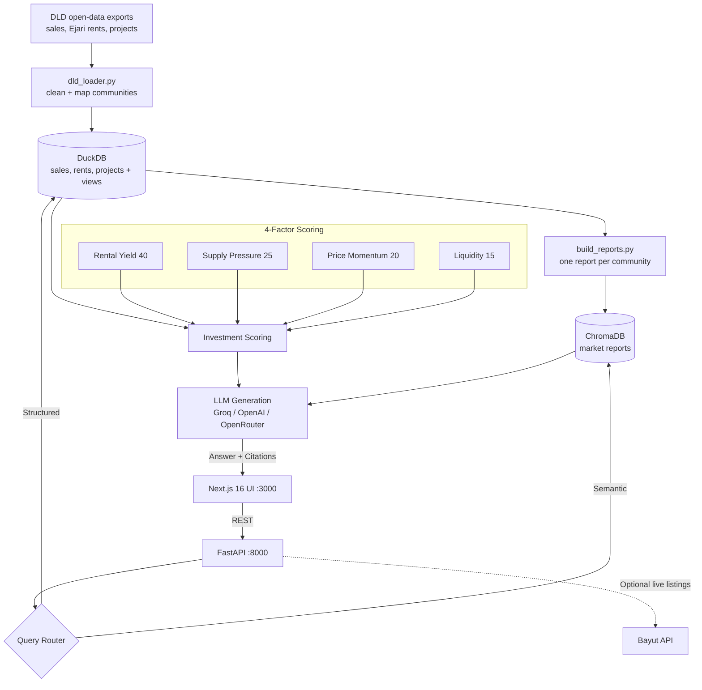

# Dubai Property Investment Assistant

AI-powered investment scoring and Q&A for Dubai apartments, built on **real Dubai Land Department open data**: 47,677 registered apartment sales and Ejari rent contracts across 29 communities (January–September 2026). It computes rental yields, measures price momentum and supply pressure, scores communities, and answers questions with citations. A community without enough rent data gets "insufficient data", never an estimate.

**Stack:** Next.js 16 + FastAPI + DuckDB + ChromaDB + Groq (LLM). Bayut API optional for live listings.

## Architecture



## Quick Start

```bash
git clone https://github.com/ahmedbasolan/dubai-property-bot.git
cd dubai-property-bot
```

**1. Export the data.** DLD's open-data gateway requires a captcha per search, so
the raw exports are a manual step (about 10 minutes). On
[dubailand.gov.ae/en/open-data/real-estate-data](https://dubailand.gov.ae/en/open-data/real-estate-data/),
download CSVs into `data/raw/dld/`, named `transactions-*.csv`, `rents-*.csv` and
`projects-*.csv`:

| Tab | Filters |
|-----|---------|
| Transactions | Sales · Residential · Unit · a date range in the current year |
| Rents | Registration Date · Residential · one month at a time (larger ranges can fail) |
| Project | Completion Date · current year |

The gateway only serves the current year. Exact filters, column codes and what
each export contains are in
[`docs/plans/2026-10-23-real-dld-data.md`](docs/plans/2026-10-23-real-dld-data.md).

**2. Build and run.**

```bash
make setup          # loader -> DuckDB -> community reports -> ChromaDB

cp .env.example .env
# Add at least one LLM key: GROQ_API_KEY (free tier), OPENAI_API_KEY or OPENROUTER_API_KEY
# Optional: BAYUT_API_KEY for live listings (RapidAPI)

make run-api        # http://localhost:8000  (docs at /docs)
make run-ui         # http://localhost:3000
```

Re-export and run `make setup` again to refresh. Adding more rent months fills in
yields for more communities.

Docker (optional): `docker compose up --build`. The API container runs the same
pipeline on start, so `data/raw/dld/` must hold the exports.

**Live demo: https://dubai-property-bot.vercel.app**. One Vercel project serves the frontend and
the API as two Services; see [`docs/deploy.md`](docs/deploy.md). The demo runs without a server
LLM key, so the chatbot answers from the data unless you add your own key in its settings.

## Pages

| Route | Purpose |
|-------|---------|
| `/` | Dashboard: KPIs, top communities, latest registered sales |
| `/communities` | Leaderboard with yield, momentum, supply and liquidity grades |
| `/properties` | Registered sales, paged, filterable by community and bedrooms |
| `/compare` | Up to 3 sales side by side |
| `/map` | Leaflet map of the 29 communities (OpenStreetMap coordinates) |
| `/trends` | Quarterly median price/sqft, sales volume, same-project momentum |
| `/calculator` | Mortgage + short-term-rental calculators |
| `/chat` | RAG chat advisor (markdown answers with tables) |

Brand assets: `/brand/brand-book.html`, `/brand/luxury-gold.html`, `/brand/showcase.html`

## What It Does

**Investment Scoring.** Each community gets a composite score (20–100) from four
factors DLD data actually supports:

| Factor | Weight | Measure |
|--------|--------|---------|
| Rental yield | 40 | Per project, median new Ejari rent per m² ÷ median ready price per m²; the community's median across projects |
| Supply pressure | 25 | Off-plan sales per ready sale in 2026: units still to be handed over |
| Price momentum | 20 | Median change of the *same projects* from Q1 to Q3 2026 |
| Liquidity | 15 | Ready sales registered |

Each factor is graded A–F and mapped to 1–5 points. Yield bands are absolute
(≥7.5% is A); the others were set from the 2026 distribution across communities.
**Recommendations are bands on that same score**: INVEST ≥ 70, HOLD ≥ 50,
AVOID < 50. **No yield, no score:** a community needs at least 3 projects with both
new rents and ready sales, and 30 such contracts; otherwise it's "INSUFFICIENT DATA". Momentum needs at least 5 projects sold in both quarters,
otherwise it's left out and the other weights are rescaled.

**Why per m² and same-project.** Ejari rows carry no bedroom count, so rents and
sales are compared per square metre, and within the same project: pooling every
rent against every sale put International City at 11.6% because a third of its
rents came from one newer tower (like for like it's 8.75%). Raw community medians move with *which*
buildings sold (Majan's median rose 52% in two quarters, Marina's 10%), while
comparing the same projects shows most communities softened 4–10% over 2026.

**Net yield** = gross yield × (1 − 8% management − 5% vacancy). It is **before
service charges**, which DLD doesn't publish, and every place it's shown says so.

## Data

All from Dubai Land Department open data, January–September 2026, cleaned by
`src/dld_loader.py`:

- **95,885 apartment sales** after removing 17 duplicates, 7,616 offices, shops
  and hotel rooms, and 669 price outliers (mostly partial or share transfers
  recorded at a fraction of value). **47,677** fall in the 29 v1 communities.
- **47,862 Ejari rents** (1–22 October 2026): single-unit residential apartment
  contracts. Rents use DLD's official area names ("Al Barsha South Fourth"), so each
  one gets its community from the area map or from its project's ready sales; 16,913
  land in a v1 community. Yields use new contracts only, since renewals lag the
  market under the RERA rent cap.
- **165 projects** completed in 2026: 79,191 apartments handed over.
- **29 communities**, chosen by rule: at least 250 ready apartment sales.
  Apartments only. Villa-only communities aren't covered, and the gateway's
  "Unit" property type is almost entirely flats.
- **One market report per community**, generated from DuckDB by
  `src/build_reports.py`, so semantic search can't contradict the structured views.

Views: `transactions`, `v_net_yield` (per-sale estimated yield), `v_community_rent`,
`v_price_momentum`, `supply_pipeline`, `price_history`, `v_community_summary`,
`v_investment_scores`.

## Example Questions

- "Compare rental yield between Dubai Marina and JVC"
- "What's the supply risk in Arjan?"
- "Is Downtown Dubai a good investment right now?"
- "How have prices in Business Bay moved this year?"
- "Which communities have the highest yields under AED 1M?"

## Tech Stack

| Component | Technology | Purpose |
|-----------|-----------|---------|
| Frontend | Next.js 16, React 19, Tailwind 4, shadcn/ui | Dashboard, chat, charts, map |
| Charts / Map | Recharts, Leaflet (react-leaflet) | Trends, scores, community map |
| Backend | FastAPI (Python) | REST API + RAG orchestration |
| Structured Analytics | DuckDB | Transaction queries, net yield, scoring |
| Semantic Search | ChromaDB | Market report retrieval |
| Embeddings | all-MiniLM-L6-v2 | Report chunk embedding |
| LLM | Groq `gpt-oss-120b` (default), OpenAI, OpenRouter | Answer generation |
| Data | Dubai Land Department open data | Registered sales, Ejari rents, projects |
| Live Listings | Bayut API (RapidAPI), optional | Asking prices |
| Design | Custom Luxury Gold design system | Brand book, logos, banners |
| Container | Docker (optional) | Deployment |

## API

Interactive docs: `http://localhost:8000/docs`

| Endpoint | Method | Purpose |
|----------|--------|---------|
| `/api/health` | GET | Service + data source status |
| `/api/chat` | POST | RAG answer (markdown). Body: `{q, provider?, api_key?, model?}` |
| `/api/chat?q=...` | GET | Deprecated; server key only, never accepts `api_key` |
| `/api/communities` | GET | Scores + recommendations |
| `/api/transactions` | GET | Paginated listing (`limit`, `offset`, `use_live=true` for Bayut) |
| `/api/scores` | GET | Investment scores |
| `/api/trends` | GET | Price/sqft time series |
| `/api/trends/top-gainers` | GET | Top gaining communities |
| `/api/trends/top-volume` | GET | Highest volume communities |
| `/api/mortgage?property_price=...` | GET | Mortgage + acquisition cost |
| `/api/developers` | GET | Reports developer scores as unavailable: DLD sales carry no developer |
| `/api/map` | GET | GeoJSON for Leaflet |

## Running Evaluations

```bash
make eval
```

> The eval set and the results below were built on the earlier generated dataset.
> Rebuilding them for the DLD data is the next step; until then treat these numbers
> as history, not a measure of the current app.

**30-question suite** with automated checks:
- Keyword matching (answer relevance)
- Percentage claims validated against the dataset's own range — a *range* check,
  not an accuracy measure: a fabricated 7.0% passes as long as the real column
  spans it (see `REVIEW.md`)
- Community attribution (entity names must exist in DB, alias-normalized)

Latest complete run (Groq `openai/gpt-oss-120b`): 29 of 30. The failure was an HTTP
413, but not because the context was 10k tokens: the context is ~5.2k, and Groq
counts the prompt **and** `max_tokens` against its 8,000 TPM cap, so the old 4k
ceiling made the request ~10k. `LLM_MAX_TOKENS` is now 1,500 with a request-budget
guard. A fresh run cleared its first 20 questions before the daily quota ran out;
its Q20 response also exposed a top-8 truncation for comparisons (fixed and
unit-tested), and Q20 was re-checked on `openai/gpt-oss-20b` and then on the 120b
itself; both now compare both scores (70 vs 63). A full 120b re-run is pending quota.

| Metric | Result |
|--------|--------|
| Successful | 29 / 30 |
| Avg keyword score | 56% |
| Percentage claims outside dataset range | 0 (reported as "100% number accuracy" in earlier revisions) |
| Community attribution | **100%** |

Harness tests: `pytest eval/test_run_eval.py` — 14 tests covering the checks themselves.

### Retrieval sampling

Transaction context is sampled across the dataset, not taken as a global top-N by
yield. On the old generated data a plain `ORDER BY net_yield_pct DESC LIMIT 15`
exposed only 5 of 24 communities, so the model reported data as missing that the
database held. The query now groups by community and ready/off-plan, ranks the
groups by scarcity so small ones are never truncated, and within each group takes
one sale per price band, so the model sees typical units rather than only the
extremes. Cap: 40 rows.

Every response also carries an exact **coverage manifest** (counts by property
type, handover status and bedrooms) plus an explicit instruction not
to total the sample rows. Without it the model cannot tell "no such property"
from "not in the rows I was shown", and it answers the second one.

The LLM request budget counts **prompt + `max_tokens`** because Groq's free tier
counts both against its 8,000 TPM limit. `LLM_MAX_TOKENS` is 1,500, and
`generate_answer()` lowers it further when the prompt grows, so a larger context
cannot turn into a deterministic 413. Single-community queries also get one
compact `price_history` line, so trend answers cite the same DuckDB series as
`/api/trends`.

### Deterministic filter extraction

`filters` used to be a parameter no caller ever populated, so every query ran
unfiltered. `src/filters.py` now derives them from the query text without an
LLM call — the same reason financial figures come from SQL views and not
generation. It extracts community (with aliases: `JVC`, `downtown`, `DSO`,
`marina` → the exact column values), property type, bedrooms and price bounds.

Two rules keep a wrong filter from becoming a false "no data" answer:

1. **Never narrow on a guess.** Bare numbers ("top 3 communities"), percentages and
   undirected prices are left unfiltered, and every omission is recorded in
   `skipped_filters` and shown to the model. A comparison ("compare Marina and
   JVC") is scoped to the communities it names — leaving it unfiltered returned all
   24 scores and then showed the top 8, so both compared communities could be
   missing from the prompt.
2. **Never narrow to nothing.** If a filter matches zero rows the query is
   retried unfiltered and the relaxation is reported in the context.

`community` is matched with `ILIKE`, not `=`, so a case-mismatched filter can't
match nothing. Communities the data doesn't cover (villa-only ones such as DAMAC
Hills 2, or Bluewaters with too few sales) are reported as not covered rather
than matched to a similar name: "DAMAC Hills 2" must never become DAMAC Hills.
Villa and penthouse searches are reported the same way, since the data is
apartments only. Community filters also scope the investment-score and supply
tables, and the semantic branch is scoped to the community's own generated report.

Tests: `pytest tests/ eval/test_run_eval.py` - 104 covering the DLD loader
(each cleaning rule on fixture exports, plus checks on the real exports that skip
without them), extraction, the relaxation safety net, semantic scoping, the eval
harness, the REST contract (paging, 404s, score/signal agreement, concurrent
requests) and data quality (AED/sqft band, trend volumes reconciling with sales,
no score without a yield).

The runner loads `.env` automatically and **resumes**: re-run `make eval` to fill in
questions that failed without redoing successes. TPM 429s retry with exponential
backoff; the request budget keeps prompt + `max_tokens` under the tier's 8k TPM, and
TPD exhaustion fails with a clear message that can be resumed after the reset.

## Project Structure

```
dubai-property-bot/
├── api/
│   └── main.py            # FastAPI app (REST + RAG endpoints)
├── src/
│   ├── dld_loader.py      # DLD exports -> clean sales, rents, projects (parquet)
│   ├── db_setup.py        # DuckDB tables, views and scoring
│   ├── build_reports.py   # One market report per community, from DuckDB
│   ├── ingest.py          # ChromaDB ingestion of the reports
│   ├── rag.py             # RAG pipeline (DuckDB + ChromaDB + LLM)
│   ├── filters.py         # Deterministic query -> SQL filter extraction
│   ├── price_trends.py    # Quarterly series + same-project momentum
│   ├── calculators.py     # Mortgage, STR yield
│   └── bayut_provider.py  # Bayut API client (live listings)
├── frontend/              # Next.js 16 app
│   └── src/app/           # dashboard, chat, communities, map, ...
│   └── public/brand/      # brand book, logos, banners
├── eval/
│   ├── eval_set.json      # 30 evaluation questions
│   ├── run_eval.py        # Evaluation runner (loads .env)
│   └── eval_results.json  # Latest results
├── tests/
│   ├── test_dld_loader.py # cleaning rules, community mapping, real-export checks
│   ├── test_data_quality.py
│   ├── test_filters.py    # deterministic extraction + relaxation
│   └── test_api.py        # REST contract (pagination, 404s, score/signal)
├── data/
│   ├── raw/dld/           # DLD exports (gitignored)
│   ├── reference/         # community map + coordinates
│   └── reports/           # generated community reports
├── docs/plans/            # data plan: sources, findings, method
├── chroma_db/             # Vector store
├── .env.example           # Keys template
├── docker-entrypoint.sh   # Builds DuckDB + ChromaDB on first container start
├── Dockerfile
├── docker-compose.yml
├── Makefile
├── REVIEW.md              # Code review: verified defects and open limitations
└── CASE_STUDY.md
```

## Design

The UI uses a custom **Luxury Gold** design system (`#D4AF37` primary, Cinzel + Josefin Sans typography). See:

- `frontend/public/brand/BRAND-IDENTITY.md` — tokens and voice
- `frontend/public/brand/brand-book.html` — full guidelines
- `frontend/public/brand/luxury-gold.html` — palette exploration

## Known limitations

`REVIEW.md` has the full list. The ones that change how results should be read:

- **5 of 29 communities have no yield or score**: Discovery Gardens, JBR, Liwan,
  Motor City and The Greens. Their rents are filed under broad official areas with
  too few project names that match their sales.
- **Rents and sales cover different windows**: rents are 1–22 October 2026, sales
  January–September. Yields compare current rents with this year's prices.
- **Nine months, one year.** The gateway serves the current year only, so trends run
  Q1-Q3 2026 and there's no year-on-year figure. Earlier years are on data.dubai.
- **Apartments only.** Villa communities and villa sales aren't covered.
- **Net yield excludes service charges** (not published by DLD), and per-sale yields
  are estimates: the community's median rent per m² applied to the unit's size.
- **No developer data.** DLD sales have no developer field, and the projects export
  links only projects completed in 2026, so developer scorecards are reported as
  unavailable.
- **Chat trends are scoped.** A single-community question gets one compact
  `price_history` line (the same series as `/api/trends`); comparisons and broad
  questions do not, to keep the prompt inside the free tier's TPM budget.
- **The eval's number check is a range check**, not per-question accuracy.
- **No authentication.** Chat is rate limited per IP (`CHAT_RATE_LIMIT_PER_MIN`,
  default 20/min) but not authenticated; never expose a funded server key publicly.